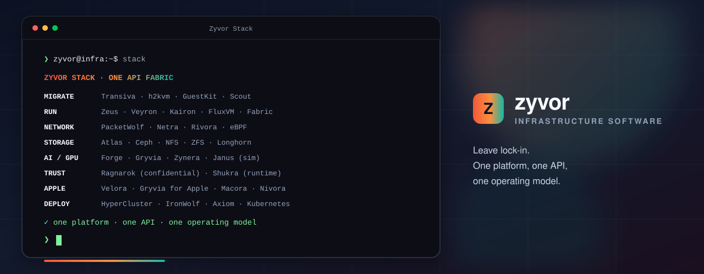

# Why Zyvor

  

<b>Open foundations. Commercial products. Operator-ready.</b>

---

## The buyer pressure

Enterprises are rewriting virtualization and private-cloud strategy:

- License shocks and lock-in on proprietary hypervisors / HCI  
- Public-cloud bills that outran the original migration thesis  
- Fragmented ops: exporters, converters, KubeVirt consoles, GPU stacks, and “hope the webhook ran”

Zyvor sells a **suite** — migrate → run → operate → scale — with Community Edition where open source belongs.

---

## What we are

| | |
|--|--|
| **KVM-honest** | KubeVirt, libvirt, and open disk formats as first-class citizens |
| **Operator-shaped** | Manuals, consoles, and trials on [zyvor.dev](https://zyvor.dev) |
| **Private-cloud native** | **Axiom** for day-2 k3s/K8s ops; **Ragnarok** for confidential attestation |
| **On-prem capable** | Edge / air-gap paths — not “our SaaS required to run your control plane” |
| **Commercial where it matters** | EULA + support on control planes; Apache-2.0 on Community tools |

## What we are not

- Not a contractual “99.99% forever” slogan  
- Not a VMware clone for its own sake  
- Not slideware without deployable software  
- Not Aether — that product is retired; **Axiom** is the private-cloud control plane  

---

## One-liners for each funnel

| Funnel | Line |
|--------|------|
| **Exit** | Discover with Scout, simulate with Chimera, convert with h2kvm, assure with GuestKit. |
| **Run** | Operate VMs and apps on Kubernetes without five consoles — Axiom, Zeus, Iris, Kryton, Haven. |
| **Operate** | GPU, metal, packets, storage intent, and reliability loops in one suite. |
| **Assure** | Argus + Kairo + KubeFlight turn specs into evidence before and after every deploy. |

---

## Proof on the website

| Surface | URL |
|---------|-----|
| Product grid | https://zyvor.dev/products |
| Axiom | https://zyvor.dev/axiom |
| Compare | https://zyvor.dev/compare |
| Pricing | https://zyvor.dev/pricing |
| Docs | https://zyvor.dev/docs |
| Blog | https://zyvor.dev/blog |

  

**sales@zyvor.dev**
